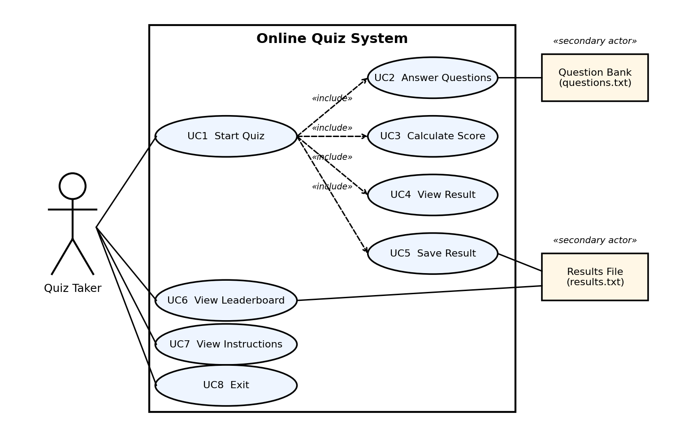

# Software Requirements Specification
## Online Quiz System
Version 1.2

**Team:** Tejas, Sanjana, Vikas, Vaishnavi
**Project:** UE24CS341A – Software Engineering, Jackfruit Phase 1

---

## Revision History

| Name | Date | Reason For Changes | Version |
|---|---|---|---|
| Tejas | Week 1 | Initial SRS skeleton created; Introduction (1.1–1.4) drafted | 0.1 |
| Vikas | Week 1 | Overall Description (2.1–2.6) added | 0.2 |
| Sanjana | Week 2 | External Interface Requirements (3.1–3.5) and Quiz Engine feature (4.2) added | 0.3 |
| Vaishnavi | Week 2 | Result Storage & Leaderboard feature (4.4), Nonfunctional Requirements (5.1–5.6), Appendices A & B added | 0.4 |
| Team | Week 2 | Consolidated all sections, corrected requirement numbering (REQ-1 to REQ-22), completed Requirement Traceability Matrix | 1.0 |
| Tejas | 12-Oct-2026 | Added UML use case diagram and use case table (3.5); added security objectives and requirements (5.3); gave NFRs IDs and measurable criteria (5.1-5.4, NFR-1 to NFR-5); fixed the pass threshold at 40% (REQ-10, BR-6); extended the traceability matrix | 1.1 |
| Tejas | 12-Oct-2026 | Simplified the wording of the document (no change to the requirements) | 1.2 |

## Table of Contents

1. Introduction
   1.1 Purpose
   1.2 Intended Audience and Reading Suggestions
   1.3 Product Scope
   1.4 References
2. Overall Description
   2.1 Product Perspective
   2.2 Product Functions
   2.3 User Classes and Characteristics
   2.4 Operating Environment
   2.5 Design and Implementation Constraints
   2.6 Assumptions and Dependencies
3. External Interface Requirements
   3.1 User Interfaces
   3.2 Software Interfaces
   3.3 Communications Interfaces
   3.4 Hardware Interfaces
   3.5 Analysis Models
      3.5.1 UML Use Case Diagram
      3.5.2 Activity Flow
4. System Features
   4.1 Main Menu & Navigation
   4.2 Quiz Engine (Question Delivery & Answer Capture)
   4.3 Scoring & Result Calculation
   4.4 Result Storage & Leaderboard
5. Other Nonfunctional Requirements
   5.1 Performance Requirements
   5.2 Safety Requirements
   5.3 Security Requirements
      5.3.1 Security Objectives
      5.3.2 Security Requirements
   5.4 Software Quality Attributes
   5.5 Business Rules
   5.6 Other Requirements
Appendix A: Glossary
Appendix B: Field Layouts
Appendix C: Requirement Traceability Matrix

---

## 1. Introduction
<!-- OWNER: Tejas -->

### 1.1 Purpose
This document specifies the software requirements for the Online Quiz System, Version 1.0. The Online Quiz System is a console-based (command-line) application developed in C/C++ that presents users with multiple-choice questions and calculates their score based on the answers submitted. This SRS describes the functional and nonfunctional requirements of the system to guide its design, implementation, and testing.

### 1.2 Intended Audience and Reading Suggestions
This SRS is for: the development team (Tejas, Sanjana, Vikas, Vaishnavi), who use it as the common reference for implementation and testing; the course faculty and evaluators, who use it to check the quality and completeness of the requirements for Jackfruit Phase 1; and team members acting as testers, who write test cases from the functional requirements in Section 4. A new reader should start with Section 2 (Overall Description), which explains the product and its environment before the detailed requirements in Section 4.

### 1.3 Product Scope
The Online Quiz System is a small, offline, console-based quiz program. A user attempts a set of multiple-choice questions and gets a score at the end. It replaces paper-based quizzes with a quick digital version, and it shows the team's understanding of core C/C++ concepts (control flow, functions, file handling) and of the software engineering process, as required for the Level 3 mini-project (UE24CS341A). The scope is kept small (Easy difficulty tier per the project problem statement): one quiz taker per session, a fixed or file-based question bank, instant scoring, and a simple leaderboard of past results. Networked multiplayer quizzes, a graphical interface, a web server, a database, and user accounts or login are out of scope for this phase.

### 1.4 References
- PES University, Dept. of CSE – "Jackfruit – Software Engineering Project Guidelines 2026" (UE24CS341A).
- Course-provided Synopsis/Problem Statement for the Online Quiz System (console-based, C/C++, Easy difficulty).
- Karl Wiegers – IEEE-style Software Requirements Specification template (structure followed by this document).
- cplusplus.com / cppreference.com – reference documentation for standard C/C++ library functions used for console I/O and file handling.

---

## 2. Overall Description
<!-- OWNER: Vikas -->

### 2.1 Product Perspective
The Online Quiz System is a new, standalone console application. It is not an upgrade of an existing system and is not part of a larger product. It runs on a single machine as one C/C++ program, with no client-server split, no backend and no database. The flow is: User ↔ Console Program ↔ (optional) local question and result files. It is a mini-project for the Software Engineering course, so it is a small, offline, single-user tool.

### 2.2 Product Functions
At a high level, the system shall:
- Display a main menu and route the user to the feature they select.
- Present multiple-choice questions one at a time and capture the user's answer.
- Track correct/incorrect answers and compute a final score and percentage.
- Optionally save each attempt's result to a local file and display a leaderboard of past attempts.

Detailed requirements for each of these functions are given in Section 4 (System Features).

### 2.3 User Classes and Characteristics
This version of the system has a single user class:

| User Class | Privileges | Characteristics |
|---|---|---|
| Quiz Taker | Use the menu, attempt the quiz, view instructions, view the leaderboard and past results | Any user running the program on a local computer; no login or account is needed; basic computer knowledge is enough |

There is no administrator role, login or web interface in this version. The question bank is kept by the team directly, not through an admin screen in the program.

### 2.4 Operating Environment
- **Client/runtime:** A terminal or console window (Windows Command Prompt/PowerShell, or a Linux/macOS terminal).
- **Language and compiler:** C/C++, compiled with a standard compiler such as GCC/g++ (or Turbo C++, if that is the toolchain specified by the course).
- **Storage:** No database is used. Results are saved in simple local text files using the standard C/C++ file functions (see Section 4.4).
- **Network:** None required — the application runs fully offline.

### 2.5 Design and Implementation Constraints
- The application must run entirely within a console/terminal — no graphical user interface (GUI) is in scope for this version.
- The system is single-user, single-session — no concurrent users and no multiplayer functionality.
- No web page, server or database is used; data is saved in local text files only.
- No login/authentication or administrator role is included in this version.
- The question bank size is limited and appropriate for a mini-project (a small, fixed or file-loaded set of multiple-choice questions).
- Git and GitHub are used for version control; individual commits are checked as evidence of each team member's contribution.

### 2.6 Assumptions and Dependencies
- The user has access to a working C/C++ compiler and a terminal to run the compiled program.
- The standard C/C++ library (console I/O, and file I/O if used) is available on the target machine — no third-party libraries are required.
- The question bank is agreed and prepared by the team before implementation, and each question is assumed to have exactly one correct option.
- The system needs no external service or network connection. Only the compiled program is needed.

---

## 3. External Interface Requirements
<!-- OWNER: Sanjana -->

### 3.1 User Interfaces
- The Online Quiz System shall provide a console-based user interface through which the user can navigate the quiz and view the results.
- The main menu shall provide options for starting the quiz, viewing the leaderboard, viewing instructions, and exiting the system. The user shall select an option by entering the corresponding choice.
- During the quiz, the system shall display one question at a time along with four answer options identified as A, B, C, and D. The system shall prompt the user to enter the selected answer.
- After the quiz is completed, the result screen shall display the user's quiz result, including the score and percentage as applicable.
- The system shall use consistent formatting for menus, questions, options, results, and prompts. Invalid user input shall be accompanied by a clear error message prefixed with "Error:" and the user shall be prompted to provide a valid input.

### 3.2 Software Interfaces
- The Online Quiz System shall run as a C/C++ console application using a standard C/C++ compiler and shall operate through a terminal or console window.
- The question bank shall contain multiple-choice questions, with each question having four answer options and exactly one correct option. The question bank shall be maintained locally by the team and shall not require an external database or web service.
- The system shall use a local text file named results.txt to store completed quiz results. Each stored record shall contain the player's name and final score. The stored results shall be read back when the user views the leaderboard.

### 3.3 Communications Interfaces
- The Online Quiz System shall operate as a standalone offline console application.
- No network connection or external communication interface shall be required for the system to perform its core functions.
- The system shall not require communication with external servers, web services, or APIs.

### 3.4 Hardware Interfaces
- The Online Quiz System shall not require any specialized hardware.
- The user shall provide input through a standard keyboard, including menu selections and quiz answers. The system shall display menus, questions, answer options, results, and error messages through the computer's console or terminal display.
- The system shall operate on standard desktop or laptop hardware capable of running the required C/C++ environment.

### 3.5 Analysis Models

#### 3.5.1 UML Use Case Diagram



The only person using the system is the **Quiz Taker**. The question bank (`questions.txt`) and the results file (`results.txt`) are shown as secondary actors because the system reads or writes them. Start Quiz includes answering questions, calculating the score, viewing the result and saving the result.

| ID | Use Case | Actor | Description | Related Requirements |
|---|---|---|---|---|
| UC1 | Start Quiz | Quiz Taker | Enters a name and takes the quiz from the first question to the result. Includes UC2 to UC5. | REQ-4, REQ-17 to REQ-22 |
| UC2 | Answer Questions | Quiz Taker, Question Bank | One question is shown at a time; the answer entered is checked and recorded. | REQ-17 to REQ-22 |
| UC3 | Calculate Score | System | Compares answers with the correct options, counts correct and incorrect answers, works out the percentage and Pass/Fail. | REQ-7 to REQ-10 |
| UC4 | View Result | Quiz Taker | Score, percentage, counts and Pass/Fail are shown after the last question. | REQ-11 |
| UC5 | Save Result | Results File | The name and score are added to the results file. | REQ-12, REQ-13 |
| UC6 | View Leaderboard | Quiz Taker, Results File | Stored results are read and shown from the highest to the lowest score. | REQ-14 to REQ-16 |
| UC7 | View Instructions | Quiz Taker | A short help screen is shown. | REQ-4 |
| UC8 | Exit | Quiz Taker | The program says goodbye and closes cleanly. | REQ-6 |

REQ-1, REQ-2, REQ-3 and REQ-5 (show the menu, check the input, ask again on bad input, return to the menu) apply to every use case that starts from the main menu.

#### 3.5.2 Activity Flow

```
              ┌─────────┐
              │  Start  │
              └────┬────┘
                   ↓
          ┌─────────────────┐
          │   Main Menu     │
          └────────┬────────┘
                   ↓
          ┌─────────────────┐
          │    Take Quiz    │
          └────────┬────────┘
                   ↓
          ┌─────────────────┐
          │ Display Question│
          │   + Options     │
          └────────┬────────┘
                   ↓
          ┌─────────────────┐
          │ Capture Answer  │
          └────────┬────────┘
                   ↓
             More Questions?
              /          \
            Yes           No
             ↓             ↓
      Display Next      ┌─────────┐
       Question         │  Score  │
             │          └────┬────┘
             └───→          ↓
                    ┌────────────────┐
                    │  Save Result   │
                    └───────┬────────┘
                            ↓
                       ┌──────────┐
                       │ Menu /   │
                       │   Exit   │
                       └──────────┘
```

---

## 4. System Features

### 4.1 Main Menu & Navigation
<!-- OWNER: Tejas -->

#### Description and Priority
The Main Menu is the entry point of the Online Quiz System. On launch, it presents the user with a numbered list of available actions — starting the quiz, viewing instructions, viewing the leaderboard of past attempts, and exiting the program — and routes the user to the corresponding part of the system based on their input. Every other feature in this system is reached through this menu. **Priority: High.** Owned by Tejas.

#### Stimulus/Response Sequences
- User launches the program → the main menu is displayed with numbered options.
- User enters a valid menu option → the system navigates to the corresponding feature (Quiz Engine, Leaderboard view, Instructions, or Exit).
- User enters an invalid or non-numeric value → the system displays an error message and redisplays the menu without crashing.
- User selects the exit option → the system displays a closing message and terminates cleanly.
- User completes a quiz attempt or finishes viewing the leaderboard/instructions → the system returns control to the main menu automatically.

#### Functional Requirements

| ID | Requirement | Priority | Verification |
|----|-------------|----------|---------------|
| REQ-1 | The system shall display a numbered menu of available actions (Start Quiz, View Leaderboard, Instructions, Exit) immediately after the program starts. | High | Functional test |
| REQ-2 | The system shall accept a single integer as menu input and validate that it corresponds to one of the displayed options. | High | Functional test |
| REQ-3 | The system shall re-prompt the user with an error message if invalid (out-of-range or non-numeric) menu input is entered, without terminating the program. | High | Negative test |
| REQ-4 | The system shall navigate the user to the correct feature (Quiz Engine, Leaderboard, or Instructions screen) based on valid menu input. | High | Functional test |
| REQ-5 | The system shall return the user to the main menu after a selected feature (quiz attempt, leaderboard view, or instructions) has finished. | Medium | Functional test |
| REQ-6 | The system shall terminate the program cleanly, without leaving any file open, when the user selects the exit option. | Medium | Functional/code review |

---

### 4.2 Quiz Engine (Question Delivery & Answer Capture)
<!-- OWNER: Sanjana -->

#### Description and Priority
The Quiz Engine shall manage the delivery of multiple-choice questions during a quiz. It shall display one question at a time along with its available answer options, accept the user's selected answer, validate the input, and proceed to the next question until all questions have been presented. **Priority: High.** Owned by Sanjana.

#### Stimulus/Response Sequences
- The user selects the option to start the quiz from the main menu.
- The system displays the first question along with its answer options.
- The user enters a selected option.
- The system validates the selected option and records the answer before displaying the next question.
- This process continues until all questions in the quiz have been presented.

#### Functional Requirements

| ID | Requirement | Priority | Verification |
|----|-------------|----------|---------------|
| REQ-17 | The system shall load the available multiple-choice questions for the quiz, with each question having exactly one correct answer. | High | Functional test |
| REQ-18 | The system shall display one question at a time along with its available answer options. | High | Functional test |
| REQ-19 | The system shall accept the user's selected answer and validate that the entered choice corresponds to one of the available answer options. | High | Functional test |
| REQ-20 | The system shall record the user's selected answer before proceeding to the next question. | High | Functional test |
| REQ-21 | The system shall proceed to the next question after a valid answer has been recorded. | High | Functional test |
| REQ-22 | The system shall continue presenting questions until all questions in the quiz have been completed. | High | Functional test |

---

### 4.3 Scoring & Result Calculation
<!-- OWNER: Vikas -->

#### Description and Priority
This feature tracks the user's correct and incorrect answers as the quiz progresses and, once the quiz is complete, calculates the final score, percentage, and an overall result classification (e.g. Pass/Fail or a grade band). **Priority: High.** Owned by Vikas.

#### Stimulus/Response Sequences
- Each answer submitted by the user (via the Quiz Engine, Section 4.2) → the system compares it to the correct option and updates the running score.
- The last question is answered → the system calculates the total score and percentage from the running tally.
- Score calculation completes → the system classifies the result (e.g. Pass/Fail) based on a defined threshold.
- Result classification completes → the system displays the final score, percentage, correct/incorrect counts, and result classification to the user.
- Result display completes → the final result data is handed off to the Result Storage & Leaderboard feature (Section 4.4) for persistence.

#### Functional Requirements

| ID | Requirement | Priority | Verification |
|----|-------------|----------|---------------|
| REQ-7 | The system shall compare each submitted answer to the question's correct option and update the running score accordingly. | High | Functional test |
| REQ-8 | The system shall separately track the count of correctly and incorrectly answered questions during the quiz. | High | Functional test |
| REQ-9 | The system shall calculate the total score and percentage once all questions in the quiz have been answered. | High | Functional test |
| REQ-10 | The system shall classify the overall result as Pass when the percentage is 40% or higher and as Fail when it is below 40%. | Medium | Functional test |
| REQ-11 | The system shall display the final score, percentage, and correct/incorrect counts to the user immediately after the quiz ends. | High | Functional test |
| REQ-12 | The system shall pass the completed result (score and percentage) to the Result Storage & Leaderboard feature for persistence. | Medium | Integration test |

---

### 4.4 Result Storage & Leaderboard
<!-- OWNER: Vaishnavi -->

#### Description and Priority
The Result Storage & Leaderboard feature stores the player's name and final score after a quiz attempt. The system saves the result to a persistent file so that previously completed quiz attempts can be retrieved later. The stored results can be displayed as a leaderboard, with entries arranged from the highest score to the lowest score. **Priority: Medium.** Owned by Vaishnavi.

#### Stimulus/Response Sequences
1. The user completes the quiz.
2. The system calculates the final score.
3. The system saves the player's name and final score to the results file.
4. The user selects View Leaderboard from the main menu.
5. The system reads the previously stored results.
6. The system sorts the results according to score.
7. The system displays the leaderboard with the highest score first.
8. If no results have been stored yet, the system displays an appropriate message instead of crashing.

#### Functional Requirements

| ID | Requirement | Priority | Verification |
|----|-------------|----------|---------------|
| REQ-13 | The system shall save the player's name and final score to a persistent file after each quiz attempt. | High | Functional test |
| REQ-14 | The system shall be able to read previously stored results from the results file. | High | Functional test |
| REQ-15 | The system shall display stored results as a leaderboard, sorted by score in descending order. | Medium | Functional test |
| REQ-16 | The system shall handle the case where no results file exists yet without crashing. | Medium | Negative test |

---

## 5. Other Nonfunctional Requirements
<!-- OWNER: Vaishnavi -->

### 5.1 Performance Requirements

| ID | Requirement | Priority | Verification |
|----|-------------|----------|---------------|
| NFR-1 | The system shall respond to each user input (menu choice or quiz answer) within 1 second on a standard computer. Showing a leaderboard of up to 100 stored results shall also take no more than 1 second. | High | Performance test (timed run) |

### 5.2 Safety Requirements
Not applicable. The Online Quiz System is a console program that does not control any physical device, so it has no safety risk.

### 5.3 Security Requirements
The system has no login and is used by one person on one computer. So its security needs are limited to three things: handling input safely, keeping the saved results correct, and not showing system details to the user.

#### 5.3.1 Security Objectives

| ID | Objective |
|----|-----------|
| SO-1 | **Do not show system details.** The program shall not show file paths, operating-system details or internal data to the user. |
| SO-2 | **Keep saved results correct.** Records in the results file shall stay in the correct format and shall not be damaged by text typed by the user. |
| SO-3 | **Do not crash.** Wrong input or a file problem shall not crash or hang the program. |
| SO-4 | **Handle input safely.** All user input shall be handled without a buffer overflow. |

#### 5.3.2 Security Requirements

All security requirements below are part of NFR-2.

| ID | Requirement | Objective | Priority | Verification |
|----|-------------|-----------|----------|---------------|
| SEC-1 | Error messages shall be a short description starting with "Error:". They shall not contain file paths, system error codes or memory addresses. | SO-1 | High | Negative test, inspection |
| SEC-2 | Before a result is saved, any comma, carriage return or new line in the player's name shall be replaced with a space, so every record stays on one `Name,Score` line. | SO-2 | High | Functional test |
| SEC-3 | All keyboard input shall be read into fixed-size buffers with a length limit (64 characters for a menu line and for the player's name). Extra characters shall be discarded without overflowing the buffer. | SO-4 | High | Negative test, code review |
| SEC-4 | If the results file cannot be opened, read or written, the system shall show an error message and return to the main menu instead of closing. | SO-3 | High | Negative test |
| SEC-5 | The question file name and the results file name shall be fixed in the program. They shall not come from user input. | SO-1, SO-2 | Medium | Code review |
| SEC-6 | When keyboard input ends (Ctrl+D or Ctrl+Z), the system shall close cleanly without looping or crashing. | SO-3 | Medium | Negative test |

### 5.4 Software Quality Attributes

| ID | Attribute | Requirement | Priority | Verification |
|----|-----------|-------------|----------|---------------|
| NFR-2 | Security | The system shall meet security requirements SEC-1 to SEC-6 (Section 5.3.2). | High | See SEC-1 to SEC-6 |
| NFR-3 | Usability | Menus, prompts and error messages shall be clear. Every invalid input shall give a message starting with "Error:" followed by a new prompt. A first-time user shall be able to finish a quiz using only the on-screen prompts. | Medium | Usability walkthrough, inspection |
| NFR-4 | Reliability | The system shall not crash when the input is invalid (not a number, out of range, empty, or longer than 64 characters) or when the results file is missing or cannot be read. It shall show an error and continue, or return to the main menu. | High | Negative test |
| NFR-5 | Maintainability | The code shall be split into separate modules: menu (`main.c`), quiz (`quiz.c`), scoring (`score.c`), and storage and leaderboard (`storage.c`). Their functions shall be declared in header files, so one module can be changed without editing the others. | Medium | Code review |

### 5.5 Business Rules
- **BR-1:** Only one quiz attempt shall be scored at a time.
- **BR-2:** Each multiple-choice question shall have exactly one correct answer.
- **BR-3:** Every completed quiz attempt shall produce a final score.
- **BR-4:** Each stored result shall contain the player's name and final score.
- **BR-5:** Leaderboard entries shall be displayed in descending order of score.
- **BR-6:** A quiz attempt is a Pass when its percentage is 40% or higher; otherwise it is a Fail.

### 5.6 Other Requirements
Not applicable. There are no other requirements beyond those above.

---

## Appendix A: Glossary
<!-- OWNER: Vikas -->

**MCQ:** Multiple-Choice Question. A question that provides multiple answer options, with one correct option.

**REQ:** A unique identifier assigned to a functional requirement in the Software Requirements Specification.

**Question Bank:** The collection of multiple-choice questions available for the quiz.

**Quiz Engine:** The system feature responsible for presenting questions, accepting answers, and progressing through the quiz.

**Score:** The number of questions answered correctly by the player.

**Result:** The final outcome of a completed quiz attempt, including the player's score.

**Leaderboard:** A list of stored quiz results arranged according to the players' scores.

**Persistent File:** A file that keeps its data after the program closes.

## Appendix B: Field Layouts
<!-- OWNER: Vaishnavi -->

**Result File**

The system shall use a persistent text file named results.txt to store completed quiz results.

Each record shall contain:

| Field | Description |
|---|---|
| Player Name | Name entered by the player |
| Score | Final score obtained in the quiz |

Example:
```
Vaishnavi,8
Tejas,9
Sanjana,7
Vikas,10
```

Each line represents one completed quiz attempt.

## Appendix C: Requirement Traceability Matrix
<!-- OWNER: Sanjana -->

| Sl. No. | Requirement ID | Brief Description | Section | Owner |
|---|---|---|---|---|
| 1 | REQ-1 | Display numbered main menu on program start | 4.1 | Tejas |
| 2 | REQ-2 | Validate menu input as a listed option | 4.1 | Tejas |
| 3 | REQ-3 | Re-prompt on invalid menu input | 4.1 | Tejas |
| 4 | REQ-4 | Navigate to correct feature based on menu input | 4.1 | Tejas |
| 5 | REQ-5 | Return to main menu after a feature finishes | 4.1 | Tejas |
| 6 | REQ-6 | Terminate cleanly on exit | 4.1 | Tejas |
| 7 | REQ-7 | Compare submitted answer to correct option, update score | 4.3 | Vikas |
| 8 | REQ-8 | Track correct/incorrect answer counts | 4.3 | Vikas |
| 9 | REQ-9 | Calculate total score and percentage | 4.3 | Vikas |
| 10 | REQ-10 | Classify result (Pass/Fail or grade band) | 4.3 | Vikas |
| 11 | REQ-11 | Display final score, percentage, and counts | 4.3 | Vikas |
| 12 | REQ-12 | Pass completed result to Result Storage feature | 4.3 | Vikas |
| 13 | REQ-13 | Save player name and score to persistent file | 4.4 | Vaishnavi |
| 14 | REQ-14 | Read previously stored results from file | 4.4 | Vaishnavi |
| 15 | REQ-15 | Display leaderboard sorted by score (descending) | 4.4 | Vaishnavi |
| 16 | REQ-16 | Handle missing results file without crashing | 4.4 | Vaishnavi |
| 17 | REQ-17 | Load multiple-choice questions with one correct answer each | 4.2 | Sanjana |
| 18 | REQ-18 | Display one question with options at a time | 4.2 | Sanjana |
| 19 | REQ-19 | Accept and validate the user's selected answer | 4.2 | Sanjana |
| 20 | REQ-20 | Record the user's answer before proceeding | 4.2 | Sanjana |
| 21 | REQ-21 | Proceed to the next question after a valid answer | 4.2 | Sanjana |
| 22 | REQ-22 | Continue presenting questions until the quiz is complete | 4.2 | Sanjana |
| 23 | NFR-1 | Process input within 1 second | 5.1 | Vaishnavi |
| 24 | NFR-2 | Security objectives SO-1 to SO-4, requirements SEC-1 to SEC-6 | 5.3 | Vaishnavi |
| 25 | NFR-3 | Usability: clear menus, prompts and error messages | 5.4 | Tejas |
| 26 | NFR-4 | Reliability: no crash on invalid input or missing files | 5.4 | Sanjana |
| 27 | NFR-5 | Maintainability: modular code structure | 5.4 | Vikas |
