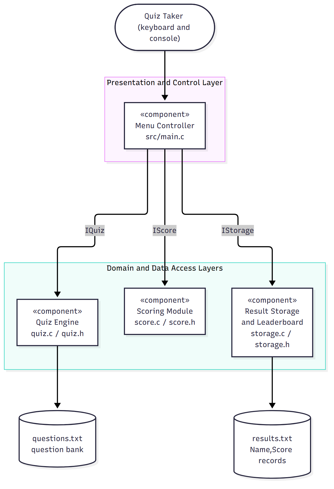
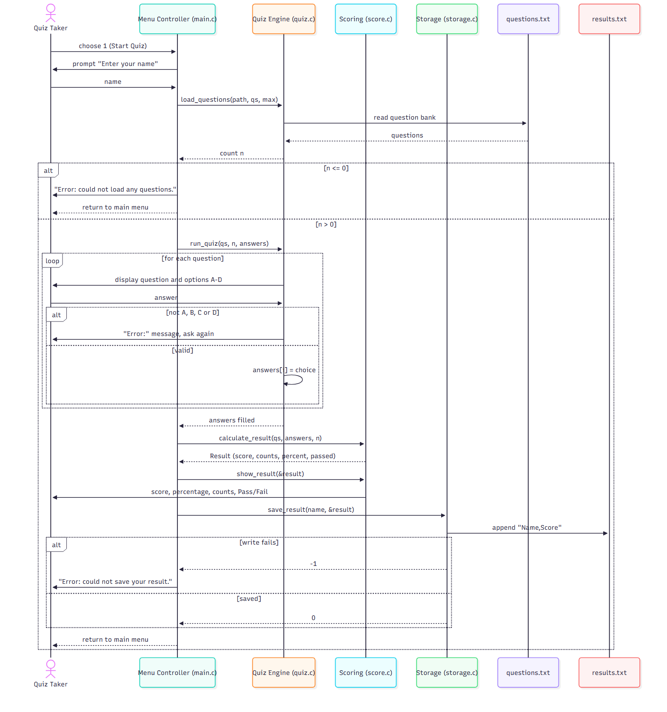
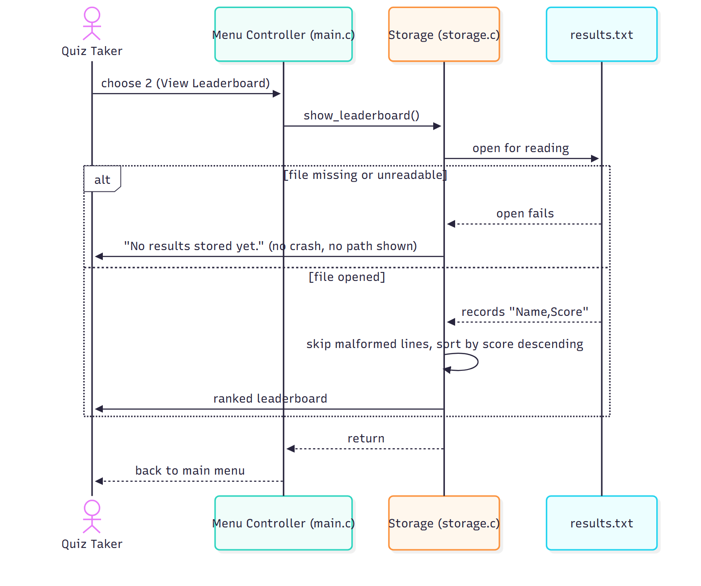

# Software Architecture and Design Specification

**Project:** Online Quiz System
**Version:** 1.1
**Authors:** Team Jackfruit (Tejas, Sanjana, Vikas, Vaishnavi)
**Date:** 12-10-2026
**Status:** Baseline for Sprint-1

## Revision History

| Version | Date | Author | Change Summary |
|---|---|---|---|
| 1.0 | 12-10-2026 | Team | First complete version, aligned with SRS v1.1 and the code on `main` |
| 1.1 | 12-10-2026 | Team | Simplified the wording (no change to the design) |

## Approvals

| Role | Name | Signature / Date |
|---|---|---|
| Project Lead / Repo Owner | Tejas | |
| Quiz Engine Owner | Sanjana | |
| Scoring Owner | Vikas | |
| Storage Owner | Vaishnavi | |

---

## 1. Introduction

### 1.1 Purpose
This document describes the architecture and design of the Online Quiz System, a console-based multiple-choice quiz program written in C. It shows how the requirements in the SRS (v1.2) are met by components, functions and data flow, so that the four team members can build their modules separately and test them against the Test Plan.

### 1.2 Scope
It covers the whole program: the main menu, the quiz engine, scoring and result display, and result storage with the leaderboard. It does not cover deployment (the program is one local executable) or anything outside the SRS scope, such as accounts, networking or a GUI.

### 1.3 Audience
Developers building the modules, testers writing test cases, the course evaluators, and anyone who works on the project later.

### 1.4 Definitions

| Term | Meaning |
|---|---|
| MCQ | Multiple-choice question with exactly one correct option |
| REQ-n | Functional requirement n in the SRS |
| NFR-n / SEC-n | Non-functional / security requirement in the SRS |
| ADR | Architecture decision record (a short note on a design choice and why it was made) |
| STRIDE | A list of threat types: Spoofing (pretending to be someone), Tampering (changing data), Repudiation (denying an action), Information disclosure (showing private data), Denial of service (stopping the program from working), Elevation of privilege (getting rights you should not have) |
| Console | Terminal window used for all input and output |

---

## 2. Document Overview

### 2.1 How to use this document
Section 3 describes the architecture (components, pattern, traceability to requirements, security). Section 4 describes the design (sequence diagrams, functions, error handling, screens). Developers should read 3.4 and 4.3 before changing a module. Testers should read 3.8 and 4.4.

### 2.2 Related documents

| Document | Location |
|---|---|
| Software Requirements Specification v1.2 | `SRS.md` |
| Software Test Plan v1.0 | `docs/TEST_PLAN.md` |
| Requirements Traceability Matrix | SRS Appendix C and Section 3.8 of this document |
| Team task split and shared signatures | `TEAM-TASKS.md` |

---

## 3. Architecture

### 3.1 Goals and Constraints

**Goals**
- Keep the program small, readable and easy to test (a mini-project, Easy tier).
- Let four people work at the same time without editing each other's files (NFR-5).
- Never crash on bad input or a missing file (NFR-4).
- Run offline on any machine with a C compiler.

**Constraints**
- Plain C (C99), built with `gcc -Wall -std=c99`; no third-party libraries.
- Console only, single user, single session; no GUI, no network, no database.
- Data is saved only in local text files.
- The shared function names and structs in `quiz.h`, `score.h` and `storage.h` are fixed, so the modules can be built at the same time.

### 3.2 Stakeholders and Concerns

| Stakeholder | Concern |
|---|---|
| Quiz taker | Clear prompts, instant result, no crashes |
| Developers (4) | Separate modules, clear ownership, function names that do not change |
| Testers | Output that can be checked, requirements that can be traced to tests |
| Evaluators | Code follows the SRS, SAD and Test Plan; proof of the process (commits, pull requests) |

### 3.3 Component (UML) Diagram



*Figure 1: Components, the functions each one offers, and the data files.*

### 3.4 Component Descriptions

| Component | Files | What it does | Functions it offers | Depends on | Owner |
|---|---|---|---|---|---|
| Menu Controller | `src/main.c` | Shows the menu, checks the menu choice, asks for the player name, calls the chosen feature, shows instructions, exits cleanly | none (entry point) | IQuiz, IScore, IStorage | Tejas |
| Quiz Engine | `src/quiz.c`, `include/quiz.h` | Loads the question bank, shows one question at a time, checks and records each answer | **IQuiz**: `load_questions`, `run_quiz` | `data/questions.txt` | Sanjana |
| Scoring Module | `src/score.c`, `include/score.h` | Compares answers with the correct options, counts correct and incorrect answers, works out the percentage and Pass/Fail (40%), shows the result screen | **IScore**: `calculate_result`, `show_result` | `Question` type from `quiz.h` | Vikas |
| Result Storage and Leaderboard | `src/storage.c`, `include/storage.h` | Adds `Name,Score` to `results.txt`, reads the results back, shows the leaderboard from high score to low | **IStorage**: `save_result`, `show_leaderboard` | `Result` type from `score.h`, `results.txt` | Vaishnavi |
| Question Bank | `data/questions.txt` | Question text, four options and the correct letter | text file | | Sanjana |
| Results File | `results.txt` (created when the program runs) | One `Name,Score` line per completed attempt | text file | | Vaishnavi |

The only link between modules is the two shared data types: `score.h` includes `quiz.h` (for `Question`) and `storage.h` includes `score.h` (for `Result`). Modules do not call each other's functions. The Menu Controller calls them one after another.

### 3.5 Chosen Architecture Pattern and Rationale

**Pattern: layered architecture (one program made of separate modules).**

| Layer | Contents | Rule |
|---|---|---|
| Presentation and control | `main.c` | Talks to the user and calls the layers below; has no scoring or file code |
| Domain | `quiz.c`, `score.c` | Quiz rules and scoring; knows nothing about the menu |
| Data access | `storage.c`, the two text files | The only code that reads or writes `results.txt` |

**Rationale.** The program has one user, runs as one process, and has three clear parts, which match how the team shares the work. Layers give each owner their own files (so pull requests do not clash), let each module be tested alone (`tests/test_score.c` uses only `score.c`), and keep file-format details out of the menu code.

**Alternatives rejected**

| Alternative | Why rejected |
|---|---|
| Client-server or microservices | There is no network and no second user; it would only make the program more complicated |
| Single `main.c` with everything inside | Four people would edit one file; modules could not be tested alone; breaks NFR-5 |
| Database for results | The SRS says no database; a text file is enough for a short leaderboard |

**Key design decisions**

| ADR | Decision | Result |
|---|---|---|
| ADR-1 | Layered modules, one source file and one header file per feature | Work at the same time, test each module alone |
| ADR-2 | Text files for questions and results | No extra software needed; a person can read the file; nothing stops someone editing it (see 3.9) |
| ADR-3 | Shared function names and structs are fixed | A module can be built before the modules it depends on exist (stubs) |
| ADR-4 | Fixed-size arrays created by the caller, no dynamic memory | No memory leaks; the question limit is `MAX_QUESTIONS` (100) |
| ADR-5 | Every module prints its own screens; errors are one line starting `Error:` | Screens look the same everywhere (NFR-3); no logging needed |

### 3.6 Technology Stack and Data Stores

| Item | Choice |
|---|---|
| Language / standard | C, C99 |
| Compiler / build | GCC, `make` (`Makefile` builds `quiz`; `make test` runs the score tests) |
| Version control / CI | Git, GitHub; GitHub Actions workflow runs `make` on every push and pull request |
| Question bank | `data/questions.txt`: for each question, one line of text, four option lines, then one line with the correct letter A to D |
| Results store | `results.txt`: one `Name,Score` line per attempt, appended |
| Platforms | Windows, Linux, macOS terminals |

### 3.7 Risks and Mitigations

| Risk | Impact | Mitigation |
|---|---|---|
| Quiz Engine not ready when others integrate | Cannot demo the whole quiz | Stubs (empty functions) with the agreed names are on `main`; scoring and storage are tested on their own |
| Question file is in the wrong format or missing | Quiz cannot start | `load_questions` returns an error; menu shows an error and continues (NFR-4) |
| Two people edit the same file | Merge conflicts | File ownership table in `TEAM-TASKS.md`; one pull request per issue, reviewed by the repo owner |
| `results.txt` edited by hand or damaged | Wrong leaderboard | Lines in the wrong format are skipped; the remaining risk is accepted (3.9) |
| Windows line endings (`\r\n`) in `results.txt` | Names end with an extra `\r` | The reader removes `\r` before reading the line |

### 3.8 Traceability to Requirements

| Requirement | Component | Function / location |
|---|---|---|
| REQ-1 Display menu | Menu Controller | `show_menu()` in `main.c` |
| REQ-2 Validate menu input | Menu Controller | `read_menu_choice()` |
| REQ-3 Re-prompt on invalid input | Menu Controller | main loop in `main()` |
| REQ-4 Navigate to feature | Menu Controller | `switch` in `main()`, `show_instructions()` |
| REQ-5 Return to menu | Menu Controller | `do ... while` loop in `main()` |
| REQ-6 Clean exit | Menu Controller | exit path of `main()` |
| REQ-7 Compare answer, update score | Scoring | `calculate_result()` |
| REQ-8 Count correct/incorrect | Scoring | `calculate_result()` |
| REQ-9 Total score and percentage | Scoring | `calculate_result()` |
| REQ-10 Pass/Fail at 40% | Scoring | `PASS_PERCENT` in `score.c` |
| REQ-11 Display result | Scoring | `show_result()` |
| REQ-12 Pass result to storage | Menu Controller, Storage | `save_result(name, &result)` call in `start_quiz()` |
| REQ-13 Save name and score | Storage | `save_result()` |
| REQ-14 Read stored results | Storage | `show_leaderboard()` (read step) |
| REQ-15 Sorted leaderboard | Storage | `show_leaderboard()` (sort step) |
| REQ-16 Missing file handled | Storage | `show_leaderboard()` |
| REQ-17 Load questions | Quiz Engine | `load_questions()` |
| REQ-18 One question at a time | Quiz Engine | `run_quiz()` |
| REQ-19 Validate answer | Quiz Engine | `run_quiz()` |
| REQ-20 Record answer | Quiz Engine | `run_quiz()` fills `answers[]` |
| REQ-21 Next question | Quiz Engine | `run_quiz()` |
| REQ-22 Continue until complete | Quiz Engine | `run_quiz()` |
| NFR-1 Performance | all | no heavy processing; input handled line by line |
| NFR-2 Security (SEC-1 to SEC-6) | all | see 3.9 |
| NFR-3 Usability | all | `Error:` prefix and re-prompt (4.5) |
| NFR-4 Reliability | all | error table in 4.4 |
| NFR-5 Maintainability | all | layering and file ownership (3.4, 3.5) |

### 3.9 Security Architecture

The system has no accounts, no network and no special rights. Bad data can come in from two places: (a) the keyboard, which cannot be trusted, and (b) the two local files, which any user of the computer can edit.

**Threat model (STRIDE)**

| Threat | Scenario | Control | Requirement |
|---|---|---|---|
| Spoofing | Typing someone else's name | Not handled: there is no login by design (single local user) | SRS 5.3 |
| Tampering | A name with a comma or new line damages the results file or fakes another record | Commas, `\r` and `\n` in the name are replaced by spaces before saving | SEC-2 |
| Tampering | Editing `results.txt` by hand | Risk accepted; lines in the wrong format are skipped | SEC-4 |
| Repudiation | Someone denies their score | Not needed for a local practice tool | |
| Information disclosure | Error text shows paths or system details | Only fixed one-line messages; no `perror`, no file names, no addresses | SEC-1 |
| Denial of service (crash) | Very long input, empty input, end of input, missing or unreadable file | Size-limited `fgets` buffers, extra characters discarded, end of input detected, every file call checked | SEC-3, SEC-4, SEC-6 |
| Buffer overflow | A long name or menu line writes past the end of a buffer | Fixed buffers (64 bytes), length checked, `strtol` with a check of the end pointer | SEC-3 |
| Elevation of privilege | Making the program open a file of the user's choice | File names are fixed in the code and never taken from input | SEC-5 |

**Security design rules for all modules**
1. Read keyboard input only with functions that have a size limit (`fgets`); never `gets` or `scanf("%s")` without a limit.
2. Check the result of every file call and every `NULL` pointer.
3. Print only the fixed messages listed in 4.4.
4. Use constants for file names.

---

## 4. Design

### 4.1 Design Overview

`main()` runs a menu loop. Option 1 calls `start_quiz()`, which asks for a name, loads the questions, runs the quiz, calculates and shows the result, and saves it. Option 2 calls `show_leaderboard()`. Option 3 prints the instructions. Option 4 or end of input leaves the loop and exits.

**Shared data structures**

```c
typedef struct {            /* quiz.h */
    char text[256];
    char options[4][128];   /* A, B, C, D */
    char correct;           /* 'A'..'D' */
} Question;

typedef struct {            /* score.h */
    int score, correct, incorrect, total;
    double percent;
    int passed;             /* 1 = Pass, 0 = Fail */
} Result;
```

`score` equals `correct` (one mark per question), so `score + incorrect == total`. `main.c` holds the questions in a static array of `MAX_QUESTIONS` (100) and the answers in a `char` array, set to zero first, so unanswered questions never count as correct.

### 4.2 UML Sequence Diagrams

**Sequence 1: Start Quiz** (REQ-4, REQ-7 to REQ-13, REQ-17 to REQ-22)



**Sequence 2: View Leaderboard** (REQ-14 to REQ-16)



### 4.3 API Design

All interfaces are C functions declared in the header files. There is no network.

#### IQuiz (`include/quiz.h`, implemented in `src/quiz.c`)

| | `int load_questions(const char *path, Question qs[], int max)` |
|---|---|
| Purpose | Read up to `max` questions from the file at `path` into `qs` |
| Returns | Number of questions loaded (>= 1), or -1 on error |
| Errors | File cannot be opened or contains no valid question: returns -1 (the caller prints the message) |
| Notes | Every loaded question has exactly one correct letter A to D |

| | `void run_quiz(const Question qs[], int n, char answers[])` |
|---|---|
| Purpose | Present questions 0 to n-1 one at a time and store each answer |
| After the call | `answers[i]` is `'A'` to `'D'` for each question that was answered |
| Errors | Invalid choice: prints an `Error:` line and asks again; end of input: returns with the remaining answers untouched (the caller sets the array to zero first) |

#### IScore (`include/score.h`, implemented in `src/score.c`)

| | `Result calculate_result(const Question qs[], const char answers[], int n)` |
|---|---|
| Purpose | Check the answers and work out the result |
| Returns | A `Result`: `score`, `correct`, `incorrect`, `total`, `percent = score / total * 100`, `passed = (percent >= 40.0)` |
| Errors | `qs` or `answers` is NULL, or `n <= 0`: returns an all-zero `Result` |

| | `void show_result(const Result *r)` |
|---|---|
| Purpose | Print score, percentage, correct and incorrect counts, and Pass/Fail |
| Errors | `r` is NULL: prints `Error: result is unavailable.` |

#### IStorage (`include/storage.h`, implemented in `src/storage.c`)

| | `int save_result(const char *name, const Result *r)` |
|---|---|
| Purpose | Append one `Name,Score` line to `results.txt` |
| Returns | 0 on success, -1 on any error |
| Errors | NULL argument, file cannot be opened or closed: returns -1 and prints nothing |
| Notes | Commas, `\r` and `\n` in `name` are replaced by spaces (SEC-2) |

| | `void show_leaderboard(void)` |
|---|---|
| Purpose | Read `results.txt` and print the entries sorted by score, highest first |
| Errors | File missing or unreadable: prints a short "no results yet" message and returns; lines in the wrong format are skipped |

#### File formats

```
questions.txt   (repeated per question)
<question text>
<option A>
<option B>
<option C>
<option D>
<correct letter A-D>

results.txt     (one per attempt)
<name>,<score>
```

### 4.4 Error Handling, Logging and Monitoring

Each error is shown as one line starting with `Error:`, and then the program goes back to a safe place (usually the menu). No error message contains a file name, path or system error code (SEC-1).

| # | Condition | Detected by | Response | Requirement |
|---|---|---|---|---|
| E1 | Menu input is non-numeric, empty, has trailing text or is outside 1 to 4 | `read_menu_choice()` | `Error: please enter a number from 1 to 4.` then the menu again | REQ-3 |
| E2 | Menu line longer than the buffer | `read_menu_choice()` | Rest of the line discarded, same message as E1 | SEC-3 |
| E3 | End of input at the menu | `fgets` returns NULL | Goodbye message, clean exit | SEC-6 |
| E4 | Empty player name | `start_quiz()` | Name defaults to `Player` | NFR-3 |
| E5 | Question file missing, unreadable or empty | `load_questions()` returns <= 0 | `Error: could not load any questions.` and return to menu | NFR-4 |
| E6 | Invalid answer during the quiz | `run_quiz()` | `Error:` line and the same question again | REQ-19 |
| E7 | Scoring called with NULL or `n <= 0` | `calculate_result()` | Zeroed `Result`; `show_result(NULL)` prints `Error: result is unavailable.` | NFR-4 |
| E8 | Results file cannot be written | `save_result()` returns -1 | `Error: could not save your result.` and return to menu | SEC-4 |
| E9 | Results file missing at the leaderboard | `show_leaderboard()` | Short "no results yet" message and return to menu | REQ-16 |
| E10 | A line in `results.txt` is in the wrong format | `show_leaderboard()` | Line skipped | SEC-4 |

**Logging.** The quiz keeps no log file, because a log file would be one more place where information could leak. Errors are shown on the screen only.

**Monitoring and checks.** The GitHub Actions build runs on every push and pull request, and `make test` runs the unit tests for scoring. Both must pass before the repo owner merges a pull request.

### 4.5 UX Design

- One screen at a time; every screen ends with a prompt.
- Menus are numbered; quiz answers are single letters A to D.
- Every error starts with `Error:` and is followed by a new prompt.
- No colour or cursor control, so it works in any terminal.

**Main menu**

```
===== Online Quiz System =====
1. Start Quiz
2. View Leaderboard
3. Instructions
4. Exit
Enter your choice (1-4):
```

**Result screen**

```
===== Quiz Results =====
Score: 4/5
Percentage: 80.00%
Correct answers: 4
Incorrect answers: 1
Result: Pass
```

### 4.6 Open Issues and Next Steps

| # | Item | Plan |
|---|---|---|
| 1 | Quiz Engine (`load_questions`, `run_quiz`) is still a stub | Sprint-1, Sanjana (REQ-17 to REQ-22) |
| 2 | Leaderboard read and sort are not implemented | Sprint-2, Vaishnavi (REQ-14 to REQ-16) |
| 3 | REQ-12 says "score and percentage" are passed to storage, but the file stores name and score only (BR-4, Appendix B) | The whole `Result` is passed; only name and score are saved. BR-4 stays as the saved format |
| 4 | The question file format is shown only by the sample file; no loader code uses it yet | Sanjana documents the format in the pull request |
| 5 | Equal scores have no set order on the leaderboard | Keep the order they appear in the file |
| 6 | Limit of 100 questions | Enough for this project; review it only if the question bank grows |

---

## 5. Appendices

### 5.1 Glossary
See SRS Appendix A. Additional terms: **Layered architecture** (modules are grouped in layers, and a layer only calls the layers below it), **Stub** (a function with the final name and arguments that does nothing yet).

### 5.2 References
- IEEE 42010: Architecture description.
- IEEE 1016: Software design descriptions.
- Online Quiz System SRS v1.2 (`SRS.md`).
- OWASP: input validation guidance; CWE-120 (buffer overflow).

### 5.3 Tools
Mermaid (component and sequence diagrams), matplotlib (use case diagram), GCC, GNU Make, GitHub Actions.
